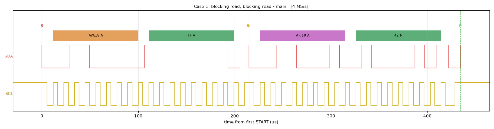
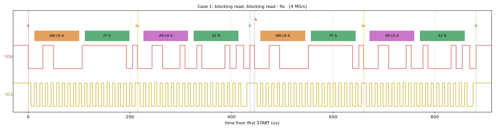
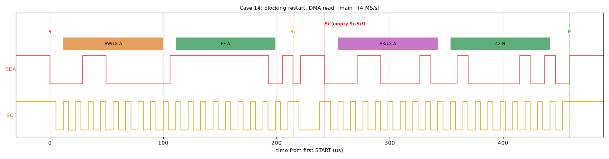
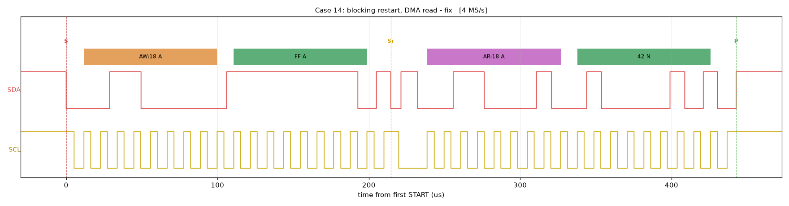

## Description

This example checks I2C controller transaction sequences against the on-board MAX9867 audio codec (address 0x18, whose revision register 0xFF reads 0x42).

It runs 14 test cases, each 1000 times back to back, covering blocking (`MXC_I2C_MasterTransaction`), interrupt-driven (`MXC_I2C_MasterTransactionAsync`) and DMA (`MXC_I2C_MasterTransactionDMA`) transactions, and sequences that mix them:

| # | Sequence |
|---|---|
| 1 | blocking read, then blocking read |
| 2 | blocking write ending in a repeated START (`restart = 1`), then a blocking read |
| 3 | blocking write to an address with no device (NACK), then a blocking read |
| 4 | blocking write with `restart = 1`, then a blocking write |
| 5 | blocking write with `restart = 1`, then a blocking write and read |
| 6 | async read, then a blocking read as soon as it completes |
| 7 | async read, then an async read |
| 8 | async write to an address with no device, then a blocking read |
| 9 | blocking write with `restart = 1`, then an async read |
| 10 | blocking write with `restart = 1`, then an async write |
| 11 | DMA read, then a blocking read as soon as it completes |
| 12 | DMA read, then a DMA read |
| 13 | DMA read from an address with no device, then a blocking read |
| 14 | blocking write with `restart = 1`, then a DMA read |

Each "read" writes the register address and reads one byte. A case passes only if every call returns the expected code, every read returns 0x42, and the bus is idle after each iteration. A case that hangs is caught by the watchdog: the device resets, reports the case as HANG, and continues with the next case. A case whose async or DMA completion callback does not arrive within 20 ms stops at that iteration and reports it. Cases 2 and 14 also report how long the read takes in I2C bit times, which shows a duplicated read.

None of the writes change a codec register: they only set the register address.

## Software

### Project Usage

Universal instructions on building, flashing, and debugging this project can be found in the **[MSDK User Guide](https://analogdevicesinc.github.io/msdk/USERGUIDE/)**.

### Project-Specific Build Notes

This project builds as a standard example. Optional build settings (pass them to `make`):

- `SCOPE_CASE=<1..14>`: capture build. After the same setup, it runs one iteration of that case every 20 ms, so a logic analyzer can trigger on it.
- `MSDK_LABEL=<text>`: prints a label for the MSDK under test in the console header.

## Required Connections

If using the MAX32690EVKIT:
-   Connect a USB cable between the PC and the CN2 (USB/PWR) connector.
-   Install JP7 (RX_EN) and JP8 (TX_EN) headers.
-   Open a terminal application on the PC and connect to the EV kit's console UART at 115200, 8-N-1.
-   No other connections are needed: the MAX9867 is on I2C2 (SDA - P1.7, SCL - P1.8).

This example requires the on-board MAX9867, so it supports the MAX32690EVKIT only.

## Expected Output

The Console UART of the device will output these messages:

```
***** I2C Transaction Test *****
I2C2 at 100000 Hz, MAX9867 at 0x18, register 0xFF (expect 0x42)
1000 iterations per case

[ 1] blocking read, blocking read
  PASS  1000/1000 ok
[ 2] blocking restart, blocking read
  PASS  1000/1000 ok
        timed call: 20.1..20.2 bit times (one read is about 20; a duplicated read adds about 19)
[ 3] blocking NACK, blocking read
  PASS  1000/1000 ok
...
[ 8] async NACK, blocking read
  PASS  1000/1000 ok
        note: async NACK write completed with E_NO_ERROR (1000/1000)
...
[14] blocking restart, DMA read
  PASS  1000/1000 ok
        timed call: 20.1..20.2 bit times (one read is about 20; a duplicated read adds about 19)

Summary: 14 PASS, 0 FAIL, 0 HANG of 14
Example Succeeded
```

A failing case prints the first error, for example `FAIL  0/1000 ok, 1000 errors (first #0 read 2: E_BUSY (-6))`, and a case caught by the watchdog prints `HANG  at iteration #0 (watchdog reset)`. Case 8 notes, but does not fail on, an async write to a missing device completing with `E_NO_ERROR`.

## Test Results

These results come from this fork; they are not part of upstream MSDK. In every table:

- **main** is MSDK main at b75575ac10, unmodified.
- **main + fix** is main with this fork's changes to
  [`i2c_reva.c`](../../../Libraries/PeriphDrivers/Source/I2C/i2c_reva.c).
- All runs are on a MAX32690EVKIT at 100 kHz, 2026-10-26.

### Across MSDK releases

The test built against each whole MSDK release, with that release's own build files. Each column links to its full console log.

| # | Case | [v2023_06](results/logs/MAX32690EVKIT-v2023_06.txt) | [v2023_10](results/logs/MAX32690EVKIT-v2023_10.txt) | [v2024_02](results/logs/MAX32690EVKIT-v2024_02.txt) | [v2024_10](results/logs/MAX32690EVKIT-v2024_10.txt) | [CFS 2.1.0](results/logs/MAX32690EVKIT-CFS-2.1.0.txt) | [CFS 2.3.0](results/logs/MAX32690EVKIT-CFS-2.3.0.txt) | [main](results/logs/MAX32690EVKIT-main.txt) | [main + fix](results/logs/MAX32690EVKIT-main%2Bfix.txt) |
|---|---|---|---|---|---|---|---|---|---|
| 1 | blocking read, blocking read | PASS | PASS | PASS | PASS | FAIL | FAIL | FAIL | PASS |
| 2 | blocking restart, blocking read | PASS | PASS | PASS | PASS | FAIL | FAIL | FAIL | PASS |
| 3 | blocking NACK, blocking read | PASS | PASS | PASS | HANG | FAIL | FAIL | FAIL | PASS |
| 4 | blocking restart, blocking write | PASS | PASS | PASS | PASS | FAIL | FAIL | FAIL | PASS |
| 5 | blocking restart, blocking write+read | PASS | PASS | PASS | PASS | FAIL | FAIL | FAIL | PASS |
| 6 | async read, blocking read | HANG | HANG | HANG | PASS | FAIL | FAIL | FAIL | PASS |
| 7 | async read, async read | FAIL | FAIL | FAIL | PASS | PASS | PASS | PASS | PASS |
| 8 | async NACK, blocking read | FAIL | FAIL | FAIL | FAIL | FAIL | FAIL | FAIL | PASS |
| 9 | blocking restart, async read | FAIL | FAIL | FAIL | PASS | HANG | HANG | HANG | PASS |
| 10 | blocking restart, async write | FAIL | FAIL | FAIL | FAIL | HANG | HANG | HANG | PASS |
| 11 | DMA read, blocking read | FAIL | HANG | HANG | FAIL | FAIL | FAIL | FAIL | PASS |
| 12 | DMA read, DMA read | FAIL | FAIL | FAIL | PASS | PASS | PASS | PASS | PASS |
| 13 | DMA NACK, blocking read | FAIL | FAIL | HANG | HANG | FAIL | FAIL | FAIL | PASS |
| 14 | blocking restart, DMA read | FAIL | PASS | PASS | PASS | PASS | PASS | PASS | PASS |
| | **PASS / FAIL / HANG** | **5 / 8 / 1** | **6 / 6 / 2** | **6 / 5 / 3** | **9 / 3 / 2** | **3 / 9 / 2** | **3 / 9 / 2** | **3 / 9 / 2** | **14 / 0 / 0** |

- Blocking cases 1-5 pass on every release up to v2024_02 and fail on main and both CodeFusion Studio bundles. This is the regression reported in msdk#1487.
- v2024_10, the release containing 79c0d9ae4d, already hangs in case 3.
- The CodeFusion Studio 2.1.0 and 2.3.0 bundles match main case for case: they ship main's `i2c_reva.c`.
- Async and DMA (cases 6-14) were not fully working on any earlier release. Their results on v2023_06 to v2024_02 change between FAIL and HANG from run to run. On main and with the fix, every run gives the same result.

### Bus captures

One iteration of each case, captured with an ADALM2000 and decoded bit by bit (see [How the results were produced](#how-the-results-were-produced)). Each cell links to the plot, and the raw samples are next to it as `.npz`.

| # | Case | main | main + fix |
|---|---|---|---|
| 1 | blocking read, blocking read | [2nd read missing](results/captures/main/case01.png) | [OK](results/captures/fix/case01.png) |
| 2 | blocking restart, blocking read | [bus held after Sr](results/captures/main/case02.png) | [OK](results/captures/fix/case02.png) |
| 3 | blocking NACK, blocking read | [read missing](results/captures/main/case03.png) | [OK](results/captures/fix/case03.png) |
| 4 | blocking restart, blocking write | [bus held after Sr](results/captures/main/case04.png) | [OK](results/captures/fix/case04.png) |
| 5 | blocking restart, blocking write+read | [bus held after Sr](results/captures/main/case05.png) | [OK](results/captures/fix/case05.png) |
| 6 | async read, blocking read | [blocking read missing](results/captures/main/case06.png) | [OK](results/captures/fix/case06.png) |
| 7 | async read, async read | [OK](results/captures/main/case07.png) | [OK](results/captures/fix/case07.png) |
| 8 | async NACK, blocking read | [blocking read missing](results/captures/main/case08.png) | [OK](results/captures/fix/case08.png) |
| 9 | blocking restart, async read | [bus held after Sr, then hang](results/captures/main/case09.png) | [OK](results/captures/fix/case09.png) |
| 10 | blocking restart, async write | [bus held after Sr, then hang](results/captures/main/case10.png) | [OK](results/captures/fix/case10.png) |
| 11 | DMA read, blocking read | [blocking read missing](results/captures/main/case11.png) | [OK](results/captures/fix/case11.png) |
| 12 | DMA read, DMA read | [OK](results/captures/main/case12.png) | [OK](results/captures/fix/case12.png) |
| 13 | DMA NACK, blocking read | [blocking read missing](results/captures/main/case13.png) | [OK](results/captures/fix/case13.png) |
| 14 | blocking restart, DMA read | [empty Sr-Sr](results/captures/main/case14.png) | [OK](results/captures/fix/case14.png) |

Case 1, two back-to-back blocking reads. On main the second read never reaches the bus (`E_BUSY`):




Case 14, a blocking write with `restart = 1`, then a DMA read. Main reports success, but puts an empty Sr-Sr on the bus:




Decoded bus traffic for each capture:

| # | main | main + fix |
|---|---|---|
| 1 | `S AW:18 A FF A Sr AR:18 A 42 N P` | `S AW:18 A FF A Sr AR:18 A 42 N P S AW:18 A FF A Sr AR:18 A 42 N P` |
| 2 | `S AW:18 A FF A Sr` | `S AW:18 A FF A Sr AR:18 A 42 N P` |
| 3 | `S AW:50 N P` | `S AW:50 N P S AW:18 A FF A Sr AR:18 A 42 N P` |
| 4 | `S AW:18 A FF A Sr` | `S AW:18 A FF A Sr AW:18 A FF A P` |
| 5 | `S AW:18 A FF A Sr` | `S AW:18 A FF A Sr AW:18 A FF A Sr AR:18 A 42 N P` |
| 6 | `S AW:18 A FF A Sr AR:18 A 42 N P` | `S AW:18 A FF A Sr AR:18 A 42 N P S AW:18 A FF A Sr AR:18 A 42 N P` |
| 7 | `S AW:18 A FF A Sr AR:18 A 42 N P S AW:18 A FF A Sr AR:18 A 42 N P` | `S AW:18 A FF A Sr AR:18 A 42 N P S AW:18 A FF A Sr AR:18 A 42 N P` |
| 8 | `S AW:50 N P` | `S AW:50 N P S AW:18 A FF A Sr AR:18 A 42 N P` |
| 9 | `S AW:18 A FF A Sr` | `S AW:18 A FF A Sr AR:18 A 42 N P` |
| 10 | `S AW:18 A FF A Sr` | `S AW:18 A FF A Sr AW:18 A FF A P` |
| 11 | `S AW:18 A FF A Sr AR:18 A 42 N P` | `S AW:18 A FF A Sr AR:18 A 42 N P S AW:18 A FF A Sr AR:18 A 42 N P` |
| 12 | `S AW:18 A FF A Sr AR:18 A 42 N P S AW:18 A FF A Sr AR:18 A 42 N P` | `S AW:18 A FF A Sr AR:18 A 42 N P S AW:18 A FF A Sr AR:18 A 42 N P` |
| 13 | `S AR:50 N P` | `S AR:50 N P S AW:18 A FF A Sr AR:18 A 42 N P` |
| 14 | `S AW:18 A FF A Sr Sr (empty Sr-Sr!) AR:18 A 42 N P` | `S AW:18 A FF A Sr AR:18 A 42 N P` |

## How the Results Were Produced

### The test code

Everything above was built from this folder's `main.c` and `project.mk`. It has three build options:

- **Default**: the test as described above.
- **`SCOPE_CASE=<n>`** (capture build): the same controller setup and case functions, then a 1.5 s pause, then one iteration of case n every 20 ms, so a logic analyzer can trigger on it.
- **`MSDK_LABEL=<text>`**: prints the MSDK under test in the header.

`main.c` also declares `MXC_I2C_DMA_Init()` and `MXC_I2C_DMA_Get{TX,RX}Channel()` as weak symbols. On releases before v2023_10, which lack them, it routes every DMA channel's interrupt instead. On later releases this changes nothing.

### Console results across releases

`tools/run_release.sh <MAXIM_PATH> <label> [console port]` does the following:

1. Copies `main.c` and `project.mk` next to that MSDK's own `Examples/MAX32690/Hello_World/Makefile`.
2. Builds with `MSDK_LABEL=<label>`.
3. Flashes with OpenOCD.
4. Saves the console output until `Example Succeeded` or `Example Failed` to `results/logs/MAX32690EVKIT-<label>.txt`.

The MSDKs tested were:

- The release tags, exported with `git archive <tag> Libraries Examples/MAX32690/Hello_World`.
- The MSDK bundled with CodeFusion Studio 2.1.0 and 2.3.0 (`SDK/MAX`).
- MSDK main at b75575ac10.
- This tree.

### Bus captures

Hardware: an ADALM2000 logic analyzer on I2C2. DIO0 goes to SCL (P1.8), DIO1 to SDA (P1.7), and GND to the board's ground. No other wiring is needed.

`tools/capture_cases.sh <MAXIM_PATH> <label> [case ...]` builds the capture build of each case, flashes it, captures and plots. The output goes to `results/captures/<label>/caseNN.{npz,png}`. It uses two tools:

- **`tools/m2k_cap.py`** drives the ADALM2000 logic analyzer through libiio, at `ip:192.168.2.1` by default. It samples at 4 MS/s, about 40 samples per I2C bit, and triggers on a START (SDA falling while SCL is high). The window is 4.1 ms, with 0.1 ms before the trigger.
- **`tools/i2c_plot.py`** decodes the capture bit by bit and plots it.
  - A SCL-high period in which SDA changes is a START or STOP condition, not a data bit.
  - Data bits are SDA at the SCL rising edge.
  - An empty Sr-Sr is marked as such. Scopy's I2C decoder misreads it as `AW:4C ... 21`.

### Reproducing

```bash
python3 -m venv venv && venv/bin/pip install -r tools/requirements.txt   # needs the libiio 0.25 C library
export PYTHON=$PWD/venv/bin/python PATH=<MSDK>/Tools/GNUTools/10.3/bin:$PATH
export OPENOCD=<MSDK>/Tools/OpenOCD/bin/openocd

tools/run_release.sh <MAXIM_PATH> <label> /dev/ttyUSB0   # console results
tools/capture_cases.sh <MAXIM_PATH> <label>                # bus captures (close Scopy first)
```

Only one program can use the ADALM2000 at a time, so disconnect Scopy from it first. If the probes are wired the other way around, set `M2K_SDA` and `M2K_SCL`. The plotter detects SCL by itself.
